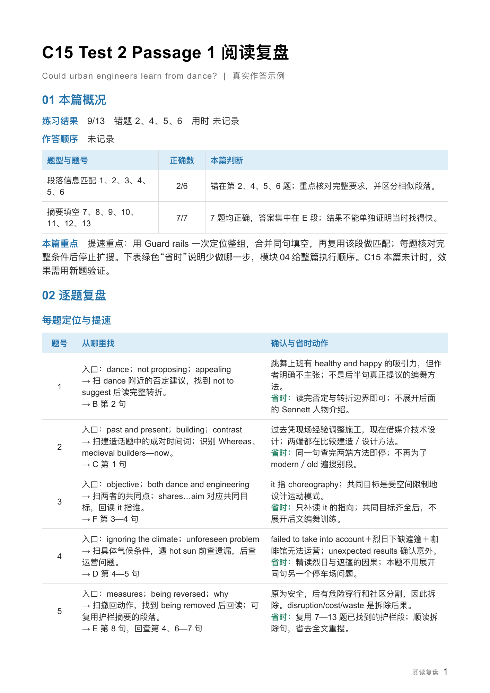

<p align="center">
  
</p>

把阅读原文、题目、自己的答案和高亮交给 Codex，得到一份**知道每题从哪里找、怎样省时、错在哪里的复盘 Word**。每篇沿用同一结构，方便回看；有计时记录时，还能排查时间花在哪一步。



[下载 C15 Test 2 Passage 1 复盘](examples/demo-review.docx) · [下载通用模板](assets/review-template.docx) · [查看原始 PDF 与作答](examples/demo-source.md)

示例来自实际练习 **C15 Test 2 Passage 1 · Could urban engineers learn from dance?**：答对 **9/13**，错题为 **2、4、5、6**。报告覆盖全部 13 题的定位路径，并对照原始 PDF 中的作答与高亮逐处复盘。本篇用时与作答顺序未记录，个人错因保留待确认。

## 每篇都用这五部分

| 模块 | 解决什么问题 |
| --- | --- |
| **01 本篇概况** | 哪种题型失分最多，这次最该先解决什么 |
| **02 逐题复盘** | 每题从哪里定位、少做哪一步；错题证据与原答案差在哪里 |
| **03 错因汇总** | 这次属于哪些错误，分别怎样练 |
| **04 下一篇怎样做** | 怎样安排题组、复用位置、暂放回查，并用新题验证速度 |
| **05 高亮修改** | 哪些词句该补标，哪些该缩短，哪些值得保留 |

每道错题保留六个字段：**作答结果 → 题目要求 → 正确证据 → 答案对比 → 错因判断 → 下次动作**。证据、判断和动作放在一起，不用来回翻找。

错因采用直白的固定名称：**词句没读懂、换个说法没认出、证据没找到、题目要求没查全、相似内容选混了、答案填写出错**。

例如，题目要求比较过去与现在，只找到“现在怎么做”还不够。复盘会指出缺少哪一端，并把下次动作写成：**分别找到过去、现在的证据，再核对比较的是不是同一件事。**

答案与高亮能提供线索，但不能还原全部作答思路。个人原因可以保持“待确认”，有依据时再列候选和简短自测。看过解析后能答，说明现在理解了，不能倒推当时为什么错。

同一结构按题型调整证据：信息匹配核对具体要求，标题匹配核对段落中心，判断题区分支持、矛盾与信息不足，填空另查字数和语法。下一篇优先练一至两个动作，说明从哪里找、何时能确定、何时先放下；用新题的正确数／题数、遗漏条件和用时检查变化。

## 让提速落到具体操作

模块02先给一张简短的定位表，**答对题也列入**。每题按“题干入口 → 扫读路线与改写 → 具体段句 → 确认条件”呈现，再单列一句绿色的 **省时动作**：复用哪题的位置、同一句能连做哪几空、什么条件齐全就停止扩读。之后保留完整错题分析。

以 C15 为例，题面就有摘要标题 `Guard rails`。用它找到护栏段后，7/8、10/11、12/13 各在同一句内连做；完成 7—13，再顺读 `being removed`、回看副作用，处理第 5 题。**省去的是每道题重新扫全文找位置。** 其他匹配题共用一轮段落扫读，遇到所需关系再精读。

用户强调速度时，模块04会明确给出 **本篇提速路线**：先做什么、复用什么、每一步省在哪里；再写何时暂放和回查，以及怎样用新材料检验。没有本篇计时也能给方案，但不会假称已经测出节省了几分钟。

如果你做得对但做得慢，附上整套／单篇用时、已知卡住的题和当时在做什么。复盘会区分**寻找位置、读懂证据、反复比较或回查**；没有过程记录时保留待确认。限时内完成情况与超时后成绩分开记录，再用新材料同时检验速度和正确率，不承诺每题固定多少秒。

## 高亮改到具体词句

高亮建议对照你实际标过的地方，直接写出“补哪句、缩成哪些词、为什么保留”。没有标记可看时，会给建议标记，不会虚构你已经高亮或漏掉了什么。

高亮修改通常集中在一页重点内，先处理影响错题判断的标记，已答对题的补标列为可选。临时定位词与最终答案证据分别判断，不因事后发现某段没出题就要求全部取消。前面的逐题分析、错因类型和方法建议始终保留。

## 装进 Codex

下载仓库，将整个文件夹放到：

```text
~/.codex/skills/ielts-reading-debrief/
```

确保 `SKILL.md` 直接位于该目录下。如果设置了 `CODEX_HOME`，则放到它的 `skills` 子目录。重新打开会话后，用 `$ielts-reading-debrief` 调用。

也可以把本地文件夹或之后上传的仓库链接交给 Codex，说：

> 请将这个项目作为 `ielts-reading-debrief` Skill 安装到我的 Codex 技能目录。

## 把材料交给它

附上原文、题目、作答及批改文件，直接说：

> 使用 `$ielts-reading-debrief` 复盘这篇阅读。文件名含 answer 的是我的答案，绿色是正确答案，红色是错答；另一份是原文，高亮是我的标记。我想加快做题速度：请给每题定位路径和具体省时动作，再给整篇做题顺序、复用位置、暂放回查与限时验证方案。保留完整错题分析和高亮修改，生成 Word。

上面的文件名与颜色只是一种示例，按你的实际情况说明即可。材料可以是 PDF、图片、Word 或直接粘贴的文本。扫描件和颜色需要实际看页面核对。

如果记录了用时、作答顺序、纠结过的选项或当时的想法，一起提供会更有帮助；没有记录也可以复盘，不补猜。

做完下一篇，或想起当时的思路，可以继续补充：

> 第 5 题我当时知道 reversed 是“撤回原有措施”，但没认出原文 being removed 对应这个意思。请根据这条补充反馈，更新错因判断和下一篇的训练动作。

## 保留这套 Word 的阅读感

中文用苹方，英文用 Arial。正文采用常规字重，标题、字段名和少量关键短语才加粗；蓝色帮助定位信息，赭棕区分错因，绿色提示下一步。长引文保持深色普通字重，表头用浅蓝底。

五模块和六字段固定，页数按内容调整。需要美化时可以直接说“只调整外观，保留全部文字与结构”。

这个 Skill 专注**答题复盘与方法修正**。必要的句意和改写会讲清；全文选句、语法拆解、同结构新句练习由独立的 `ielts-close-reading` Skill 处理，两者可以分别使用。

<details>
<summary>想复现示例或调整默认样式</summary>

平时直接交给 Codex 即可。下面的脚本只负责数据校验与排版，不独立完成阅卷和错因推理。

在仓库根目录运行：

```bash
python -m pip install -r requirements.txt
python scripts/build_review.py examples/demo-review.json --check-only
python scripts/build_review.py examples/demo-review.json --output output/demo.docx
```

生成依赖 Python 与 `python-docx`，逐页视觉检查另需可用的文档渲染工具。默认字体对应 macOS；其他环境用 `--cjk-font`、`--english-font` 指定已经安装的字体，并检查成品字形与分页。项目不分发字体。

- [Skill 入口](SKILL.md)：何时使用、如何复盘与交付。
- [内容标准](references/review-standard.md)：证据、错因、方法和高亮的写法。
- [题型规则](references/question-types.md)：按本篇题型选择证据与比较方式。
- [定位与计时](references/locating-and-timing.md)：每题如何找、卡住时如何继续，以及如何验证速度。
- [Word 排版](references/word-layout.md)：字体、配色、留白与分页。
- [样式参数](assets/word-style.json)：可调整的默认值。
- [数据格式](references/data-format.md)与[示例数据](examples/demo-review.json)：如何复现生成过程。

</details>

这是一套基于材料的复盘流程，不是官方题库，也不代替正确答案核验。
